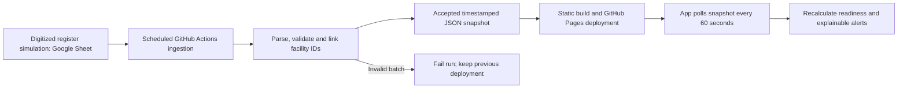

# InnoMama AI

**A clearer signal. A safer beginning.** An InnoHealth Technologies maternal-health research prototype for Northern Nigeria.

**[Open the synthetic-data web demo](https://nahsc0.github.io/innomama-ai/)** · [Source repository](https://github.com/Nahsc0/innomama-ai)

## Problem statement and motivation

Maternal care depends on both a woman's condition and the facility's ability to respond. Routine records and inventories often sit apart, obscuring missing observations, supplies or referral resources. InnoMama explores a connected early-warning workspace for primary healthcare teams. The motivating question is whether time-linked signal-function indicators add useful information to maternal observations when identifying elevated risk of defined complications.

This demo does **not** predict survival, maternal death, or a successful delivery. It uses transparent illustrative rules on synthetic data. No model has been trained or clinically validated. The AI name describes the intended research direction. Do not use this prototype to make clinical decisions or enter real patient data.

## Research foundation

Tomlin and colleagues (2020) assessed routine-care readiness with four functions: labour monitoring, third-stage care, infection prevention and clean cord care. Every required component must be present. Deliveries were linked to facility readiness to measure coverage. The app reproduces that historical checklist, including its oxytocin-or-ergometrine definition; missing or unknown components fail readiness. The checklist is a measurement definition, not prescribing guidance. [Paper and full methods](https://doi.org/10.1186/s12884-020-02926-8).

The additional indicators are proposed extensions, kept distinct from that checklist:

| Evidence | Contribution | Limitation |
| --- | --- | --- |
| [Payne et al., miniPIERS, 2014](https://doi.org/10.1371/journal.pmed.1001589) | Maternal observations, symptoms, parity, gestation and outcome-window design | Hypertensive-disorder population; not a general maternal mortality model |
| [Yang et al., PIERS-ML/fullPIERS, 2025](https://doi.org/10.1371/journal.pmed.1004509) | Repeated assessment requires validation over time | Performance at admission cannot simply be assumed to persist |
| [Maternal Early Warning Criteria, 2014](https://doi.org/10.1097/AOG.0000000000000480) | Physiological trigger precedent | App rules are an illustrative subset and additions, not a validated implementation |
| [WHO antenatal care, 2016](https://www.who.int/publications/i/item/9789241549912) | Eight-contact care context | Contact timing and care quality matter; count alone is not a risk model |
| [WHO postpartum haemorrhage guidance, 2025](https://www.who.int/publications/i/item/9789240115637) | Track uterotonic availability, including misoprostol, separately | Stock, actual administration, indications and outcomes must remain distinct |
| [WHO emergency obstetric care handbook](https://www.who.int/publications/i/item/9789241547734) | Actual performance matters for emergency functions | Supplies alone do not establish EmONC performance |

Three open-access paper PDFs were downloaded locally (excluded from public Git and deployment) into `research/`: the motivating Tomlin paper, miniPIERS, and the 2025 PIERS study. Their publisher links remain in the app. See [research notes](research/NOTES.md) for the evidence map and research protocol outline. This is a focused implementation review, not a systematic literature review.

## Process

1. Capture a synthetic maternal assessment and associate it with a synthetic facility.
2. Evaluate the four routine-care functions using all-components-required logic.
3. Check configured maternal observations, contextual care gaps and missingness separately.
4. Display reasons in an ordered review queue. Urgent observed triggers take precedence over missing data; missing data otherwise receive an incomplete status.
5. Let a tester edit inventory, update review status, inspect the activity log and export the demo state.

The dashboard's delivery-weighted readiness is the share of synthetic facility deliveries associated with facilities meeting all four historical functions. It is not a probability of survival. All charts and counts derive from the current demo records.

## Actions and expected results

The intended workflow makes a missing signal visible, supports clinical review and helps coordinate readiness improvements. In this demo, a systolic pressure of 166 produces an urgent trigger; an unknown oxygen saturation yields an incomplete assessment; absent skilled attendance makes all four functions incomplete. Changing a facility inventory recalculates linked priorities immediately. Review acknowledgement never suppresses a trigger. Referral status is a simulation and sends no messages.

Demo triggers: systolic BP ≥160 or <90; diastolic BP ≥110; pulse >120 or <50; respiratory rate >30 or <10; oxygen saturation <95%; reported bleeding, seizure or breathlessness yield Urgent. Temperature ≥38 or <36, intermediate elevated BP, headache/visual disturbance, prior complications, haemoglobin <11, fewer than eight ANC contacts at ≥36 weeks, incomplete routine functions or unconfirmed transport yield Review unless superseded. Missing required observations produce Incomplete unless urgent signs are present. These thresholds and routing are not a complete clinical protocol; local specialist review is required.

No clinical effectiveness results exist. Twenty-five automated tests verify critical rule, pipeline, analytics and escalation behavior; browser testing verifies the interface and workflows. This demonstrates a usable product concept, not evidence that the app prevents mortality.

## Product features

- Responsive overview, maternal registry, priority filters and record search.
- New assessments and editable observations with numeric constraints and missing-value handling.
- Explainable maternal priorities and original routine-care readiness checklist.
- Editable facility stock including misoprostol, magnesium sulphate, antibiotics, newborn resuscitation and transport.
- Review coordination status, browser-local activity history, JSON export and demo reset.
- Evidence library with downloaded papers and an explicit AI validation pathway.

## Run and test

Requires Node.js 20 or later; no package installation or API key is needed.

```sh
npm start
# Open http://127.0.0.1:4173
npm test
npm run build
```

`dist/` is the deployable static app. The GitHub Actions workflow tests, builds and deploys it to GitHub Pages. In repository Settings → Pages, choose GitHub Actions. All asset paths are relative, supporting project-site hosting.

## Connected NHMIS-style data pipeline (v1.1, 3 November 2026)

The app now opens in **Connected register** mode, backed by this editable [synthetic Google Sheet](https://docs.google.com/spreadsheets/d/1yP0NPr-m1DgfDP3Fp_ceb1kn2oMaD0suEIfqB2_4fT8/edit). The Sheet is in the `ChatGPT` folder in My Drive and contains `Maternal_register`, `Facilities` and `Guide`. It simulates a digitized register; it is not an official NHMIS form or national NHMIS integration. All rows are invented.



### Refresh and ownership

- The server-side workflow runs on pushes, manual dispatch and a five-minute cron schedule (`2-57/5 * * * *`, UTC). It continues while no browser is open. GitHub may delay or skip scheduled runs; this is near-real-time polling, not a guaranteed five-minute service. See [GitHub schedule documentation](https://docs.github.com/en/actions/reference/workflows-and-actions/workflow-syntax#onschedule).
- Each successful ingestion reads the two source tabs through Google's unauthenticated CSV query endpoint. The **synthetic-only workbook has anyone-with-the-link Viewer access** so the public demo needs no key or embedded credential. See [Google's spreadsheet data-source access guidance](https://developers.google.com/chart/interactive/docs/spreadsheets).
- Every accepted batch records ingestion time, source URL, schema version and a SHA-256 source-content hash. Workflow runs and their deployment artifacts provide the run history. The initial snapshot is versioned in Git; recurring data updates are deployed artifacts, not an endless sequence of source commits. Google Drive maintains Sheet edit history.
- The app checks the same-origin deployed snapshot every 60 seconds, and **Check feed** checks immediately. It cannot force GitHub ingestion; use Actions → workflow → Run workflow for an immediate source check. GitHub queue, Google caching and Pages deployment add latency.
- **Connected register** is read-only in the app; change source data in Google Sheets. **Local sandbox** preserves the earlier editable demo, assessments and review tracking without writing back to Google or mixing local edits into the feed. Export reflects the selected view.

### Schema and quality controls

One source row is the current assessment for a unique synthetic `record_id` such as `IM-001`, joined through `facility_id`. Editing that row updates it on the next successful ingestion. Duplicate IDs are rejected; longitudinal encounter history is outside this demo's current schema. Field names and measurement units are listed in [pipeline schema](pipeline/schema.js) and the Sheet's `Guide` tab. Maternal rows collect age, gestation, ANC contacts, blood pressure, pulse, respiration, oxygen saturation, temperature, haemoglobin, symptoms, prior complications, parity and dipstick proteinuria. Parity and proteinuria are retained for research and are not scored by the demo engine.

Facility rows include the original four-function components plus misoprostol, magnesium sulphate, antibiotics, transport and resuscitation equipment. `observed_at` is the source observation time in UTC; `generatedAt` is ingestion time. The app displays ingestion freshness, which does not establish that an old clinical observation is current. Refresh source timestamps when collecting new observations.

Validation enforces exact headers, required stable IDs, unique records, facility joins, a synthetic marker, UTC timestamps, explicit symptom booleans, numeric ranges and plausible systolic/diastolic ordering. Blank numeric values and blank stock values remain unknown. Any invalid source row rejects the batch, and deployment stops. The parser caps input size and row count (up to 1,000 source rows per tab). It does not infer missing values or silently discard invalid records. The synthetic marker is an assertion, not a detector of private information.

If ingestion fails, the previous deployment remains available. If the browser fetch fails or receives an invalid snapshot, it retains its last accepted snapshot and displays a connection warning. A snapshot older than 15 minutes is labelled **Delayed feed**. Before any successful sync, bundled records are labelled an offline sample. Cached snapshots retain their original ingestion timestamps. No stale snapshot is relabelled as newly ingested.

### Try the pipeline

1. Open the source Sheet as its owner. In `Maternal_register`, change an invented observation, or in `Facilities`, change a stock boolean. Keep headers, identifiers and `synthetic=TRUE` intact.
2. Wait for a scheduled run, or manually dispatch the workflow in [GitHub Actions](https://github.com/Nahsc0/innomama-ai/actions). A successful run ingests, validates, tests, builds and deploys the new snapshot.
3. Open the app in Connected register mode. Use Check feed after deployment, or allow its next one-minute poll. The ingestion timestamp, relevant observations, readiness and alerts update together.
4. For an invalid-data demonstration, use an out-of-range invented value and run ingestion. Confirm validation fails and the published app keeps its previous snapshot. Correct the Sheet before the next run.

Local commands: `node pipeline/sync.mjs`, `npm test`, `npm run build`. The committed `pipeline/config.json` contains only public source identifiers, never credentials. Never place real clinical records in this public Sheet, repository or deployment. A real NHMIS integration requires an authorised authenticated server-side connector, approved schema mapping, patient privacy controls, provenance, encounter history and clinical validation.

### Branding change

The supplied InnoHealth reference informed the cobalt / midnight-blue / white palette and bright-green connection accent. The application now carries an SVG adaptation of the InnoHealth wordmark alongside InnoMama AI. The reference flyer itself, portraits, QR code and event details are not shipped. This is a reference-derived wordmark treatment, not a new trademark clearance.

### Change tracking

| Version | Change | Verification |
| --- | --- | --- |
| 1.0 | Original synthetic maternal surveillance demo | Core readiness and priority-rule tests; browser workflows |
| 1.1 | InnoHealth branding, native Google Sheet, scheduled ingestion, schema validation, timestamp/hash provenance, automatic app refresh, explicit connected/sandbox modes | Pipeline parser/validation tests, source readback, live integration and browser checks |

## Regional analytics and response centre (v1.2, 3 November 2026)

Open **Analytics** from the navigation, or use the [direct dashboard link](https://nahsc0.github.io/innomama-ai/#analytics). The same Google Sheet now contains **160 synthetic current assessments linked to 41 invented facilities across all 19 northern states and the FCT**. Existing Gombe records were preserved; additional scenarios were appended. FCT is displayed separately as a territory, not counted as a twentieth state. This is a simulated deployment, not a claim of operational coverage.

The `Facilities` source schema adds `state`, `latitude` and `longitude` after `synthetic`. New geographic rows require a recognised northern state/FCT and numeric coordinates within the supported Nigeria range. Locations are illustrative reference points, not actual facility addresses or navigation directions. The ingestion query now reads through column `AB`. Old 25-column snapshots remain readable for backward compatibility and are mapped to the original Gombe demonstration; the current source uses the expanded 28-column schema.

### Dashboard and denominators

State/territory, facility, urgency and indicator filters apply together. The facility list narrows when a state is chosen. State and facility-dot map clicks, priority legend clicks and gap-bar clicks also set those filters. Reset restores all records. An empty intersection displays zero counts and an empty state, without changing the denominator to another cohort. The filtered export includes every matching assessment, its facility, rule reasons and gaps; the on-screen detail table shows the first 80, with an explicit count and advice to narrow filters.

| View | Definition |
| --- | --- |
| State choropleth | Filtered urgent assessment counts; darker red means a larger count. No matching data, no urgent triggers and states outside the simulated deployment have distinct legend meanings. This is not a mortality rate or population comparison. |
| Priority donut | Counts of matching assessments in Urgent, Incomplete, Review and No triggers. Categories sum to the filtered cohort. |
| Missing signals / care gaps | Number of matching mothers linked to an unavailable or unknown item, a missing observation or the specified maternal/context trigger. Multiple gaps per mother are possible. Medicine availability does not imply clinical indication, administration or causation. |
| Routine-care readiness | Distinct linked facilities satisfying each original all-components-required function, divided by distinct facilities linked to matching mothers. |
| ANC and gestational-age charts | Current recorded contact-count and gestation categories for matching mothers. ANC counts are contextual and do not apply an eight-contact target to every gestational age. |

Boundaries come from [geoBoundaries gbOpen / GRID3](https://www.geoboundaries.org/api/current/gbOpen/NGA/ADM1/), Nigeria ADM1 (represented year 2022), under CC BY 4.0. Geometry is rounded and projected to SVG for local, key-free map rendering. Attribution and the pinned source URL are in [MAP-LICENSE](assets/MAP-LICENSE.md). Northern zone grouping follows the [National Bureau of Statistics regional classification](https://www.nigerianstat.gov.ng/pdfuploads/IGR_FULL_REPORT.pdf). The map is for exploration, not a legal boundary reference.

### Named algorithm for action

**Signal Priority Rules v1.2.0** is a deterministic rule engine, combined with conjunctive (all-components-required) routine-care readiness. It is not a trained ML classifier and does not implement miniPIERS/fullPIERS or estimate an outcome probability. The exact current thresholds appear in the app's **Evidence & AI** view and in the trigger description above.

Order of precedence: (1) observed urgent physiological/symptom triggers → **Urgent**; (2) missing required observations → **Incomplete**; (3) maternal/context or readiness flags → **Review**; otherwise → **No triggers**. Urgent signs always override missingness. Missing medicine or staffing alone does not become a clinical emergency. The app preserves and displays the reasons for each priority. The newly added geographic fields, parity and proteinuria do not acquire invented predictive coefficients.

### Automatic escalation and officer contacts

The **[Escalations](https://nahsc0.github.io/innomama-ai/#escalations)** response centre creates an outbox record automatically for each urgent observation while this browser is running and has an accepted snapshot. Every record includes the pseudonymous case ID, facility, rule version, trigger reasons, message preview, timestamp and recommended response workflow. Repeated polls do not duplicate the same observation and trigger set. A new observation timestamp or a changed trigger set can create a new alert. Local sandbox and connected-view alert histories are separate.

Each facility has a browser-local officer form for a dummy name, internationally formatted mobile number and synthetic-data confirmation. Contacts can also be uploaded as CSV, with exact headers:

```csv
facility_id,officer_name,phone,synthetic
f1,Demo officer,+2340000000000,TRUE
```

The app provides a CSV template and a **Load dummy contacts for all facilities** button. Import rejects unknown facility IDs, duplicate rows, invalid phone formats and non-synthetic markers before applying any row. Missing contacts block the item. Saving a valid dummy contact prepares that same blocked item; acknowledgement survives refreshes. Contacts and response logs stay in this browser and are not uploaded to the public Sheet, repository or snapshot. Exporting the response log includes the dummy contacts. No real contact details should be used in this public prototype.

**SMS is a simulation, not a live delivery integration.** The product owner chose to select an SMS provider later; this release intentionally delivers the testable simulation. `Simulated queued` means a message was prepared locally, not sent or delivered. `Acknowledged (simulation)` records a tester's action, not completed care. No provider account, sender number, paid service, server API, delivery receipt or background clinical dispatch is configured. Closing all app tabs stops this local simulation; the scheduled Sheet ingestion continues independently. Simulated alerts are reconstructed from the current accepted snapshot when the app reopens, not from a complete event history.

For an actual SMS service, implement an authenticated server-side dispatcher alongside ingestion, a governed contact registry, verified recipients and an approved sender/provider. Keep credentials off GitHub Pages. Use server-side idempotency keys, delivery webhooks with signature verification, retry limits, delivery failure monitoring and an alternative contact route. Clinical teams must approve escalation priorities, consent and data minimisation. This requires a separate production service and provider configuration; it cannot be supplied by GitHub Pages alone.

### Recommended immediate action workflow

The app recommends contacting the facility officer/care team promptly, reaching the mother or carer through that team to establish current location and condition, arranging qualified maternity assessment, and coordinating urgent referral/transport under the local protocol if necessary. It prompts recording contact attempts, handover and acknowledgement. Do not wait for an SMS to act. These are workflow prompts for a clinician-owned protocol, not autonomous diagnosis, medication instructions or a guarantee of a successful delivery.

### Verification and change tracking

Core tests now cover the rule engine, pipeline, combined analytics filters, distinct-facility denominators, empty selections, missing data, urgency-only escalation, deduplication, new-observation re-alerting, blocked-contact recovery, acknowledgement preservation and CSV validation. Browser checks cover map selection, intersected filters, charts, contact registration/upload, response tracking, export and responsive layouts. Changes are versioned in Git and summarised in [CHANGELOG](CHANGELOG.md).

## Architecture details

Buildless HTML, CSS and JavaScript modules; pure assessment logic in `engine.js`, synthetic fixtures in `data.js`, interface in `app.js`, polling/cache in `feed.js`, and ingestion/validation in `pipeline/`. GitHub Actions provides scheduled server-side ingestion and deployment. Local storage retains sandbox changes and the last accepted feed cache on the same browser. No clinical backend, patient authentication or notification service exists. Fonts may load from Google Fonts, with system fallbacks. The local server is for development only.

Public GitHub Pages hosting is appropriate for this synthetic demonstration. It is not a production clinical data platform. A future deployment needs secure identity and role permissions, encrypted clinical storage, monitored services, provenance, consent/governance, regulatory review and a clinician-owned escalation protocol. The local activity log is editable browser data, not a tamper-evident clinical audit trail.

## Research pathway to meaningful AI

Define population, index time and outcomes before modelling. Proposed primary endpoint: adjudicated severe maternal morbidity within a pre-specified short horizon, with mortality through 42 days analysed separately. Define newborn endpoints separately. Recruit enough events for model development and validation rather than relying on the number of records alone. Capture parity, proteinuria and relevant laboratory values in a governed research dataset; the demo does not yet collect all candidate predictors.

Collect prospective patient-to-facility linkage, time-stamped measurements, ANC timing/content, prior history, actual care administered, repeated inventories, staffing, stock expiry/cold-chain integrity, referral travel time and follow-up after transfer/discharge. Never infer that stocked medicine was administered. Avoid leakage from delivery or treatment data recorded after the prediction time. Treatment variables may reflect illness severity, creating confounding by indication.

Compare a pre-specified clinical baseline, regularised regression and suitable machine-learning models. Use facility-grouped and temporal splits, training-only imputation, calibration assessment, sensitivity, specificity, precision, PR-AUC, decision-curve utility and confidence intervals. Evaluate subgroup and missingness performance. Externally validate in other facilities and states, run prospective silent testing and assess clinical impact before adoption. Include alert fatigue, workload and safe fallback processes.

## Ownership

Product concept: **InnoMama AI by InnoHealth Technologies**. Branding is provisional and has not undergone a trademark clearance. Third-party papers retain their own licenses; app source and downloaded publications are distinct works.


## Readability and interaction update — UI v1.3.0

The interface now uses a 16px base size, at least 14px for secondary HTML text, larger headings and 44px minimum primary control targets. The header's **Text size** selector offers Standard (16px), Larger (18px) and Largest (20px); the preference is saved on this browser and scales rem-based interface text across pages. SVG labels use chart coordinate units, with full state details available through focus/hover and the accessible state-count table.

Analytics supports removable filter chips, full-row clickable care-gap bars (also Enter/Space), selected priority-legend feedback, and a readable map detail panel on hover or keyboard focus. State, facility, priority and indicator filters continue to intersect; clearing the state also clears its dependent facility. Matching counts are announced as a status update. Larger form controls, visible keyboard focus and responsive layouts improve touch and keyboard use. Tables scroll within their cards on narrow screens.

Validation: all 25 existing tests passed, build succeeded, and browser checks covered state selection, chip removal, keyboard care-gap/map selection, persistent largest text setting after reload, and mobile layout at 390px plus desktop at 1440px. This UI update preserves Signal Priority Rules v1.2.0, the Google Sheet pipeline and simulated SMS behaviour.
